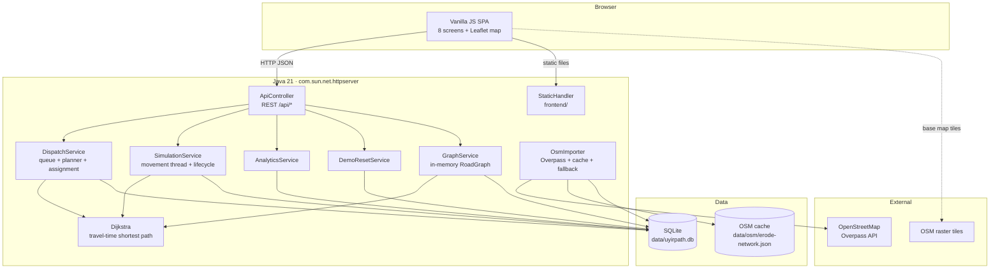
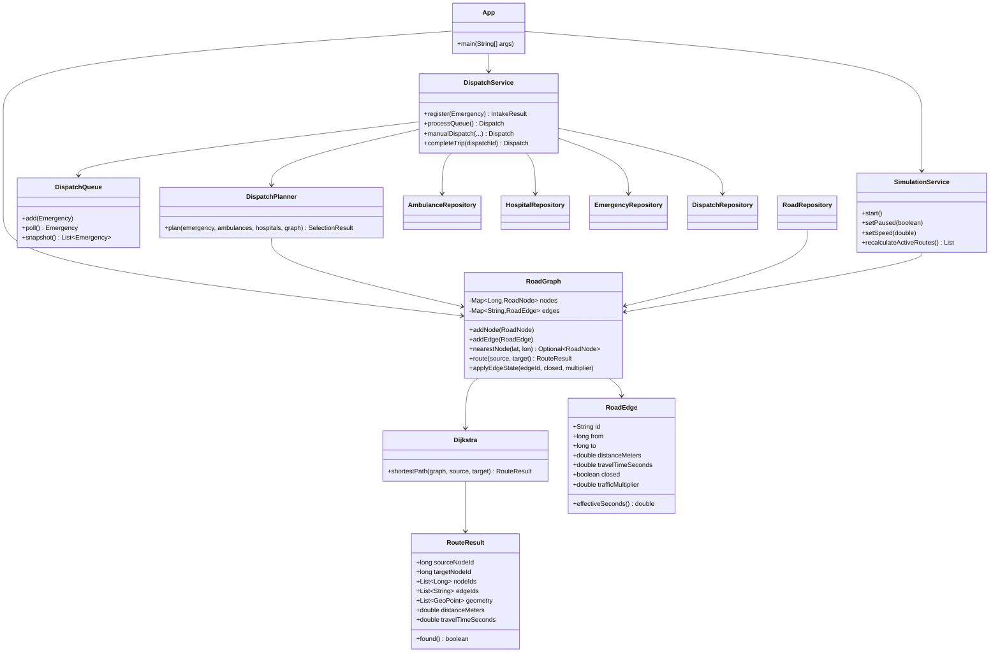

# UyirPath Architecture

## 1. Design goals

1. **Routing must be explainable.** The route decision is produced by our own
   Java Dijkstra implementation, never by an external routing engine.
2. **Durable state.** SQLite is the source of truth; the in-memory priority queue
   and graph are rebuilt from it.
3. **No duplicate dispatch.** A database transaction plus partial unique indexes
   make double assignment impossible even if two requests race.
4. **Honest simulation.** Simulated movement, beds, traffic and closures are
   labelled everywhere they appear.
5. **Zero framework magic.** Plain Java 21, JDK HTTP server, vanilla JS/Leaflet.

---

## 2. Component diagram



---

## 3. Class diagram (core)



---

## 4. Dispatch sequence

```mermaid
sequenceDiagram
  actor Operator
  participant UI as Browser SPA
  participant API as ApiController
  participant DS as DispatchService
  participant Q as DispatchQueue
  participant P as DispatchPlanner
  participant G as GraphService/Dijkstra
  participant DB as SQLite

  Operator->>UI: Pick location + severity + facility
  UI->>API: POST /api/emergencies
  API->>DS: register(emergency)
  DS->>G: snap to nearest OSM node
  DS->>DB: insert emergency (QUEUED)
  DS->>Q: add (priority, seq)
  DS->>Q: snapshot in priority order
  DS->>P: plan(emergency, ambulances, hospitals)
  P->>G: Dijkstra ambulance → scene
  P->>G: Dijkstra scene → hospital
  P-->>DS: selected ambulance + hospital + full candidate reasons
  DS->>DB: BEGIN; reserve ambulance WHERE status='AVAILABLE';
  DS->>DB: insert dispatch; update emergency WHERE status='QUEUED'; COMMIT
  DS-->>API: IntakeResult
  API-->>UI: emergency + dispatch + selection + message
  UI->>UI: draw route geometry, cards, intelligence
```

If the conditional ambulance update or emergency update affects zero rows, the
transaction rolls back and the emergency remains queued. The partial unique
indexes `ux_active_dispatch_ambulance` and `ux_active_dispatch_emergency` are a
second line of defence.

---

## 5. Routing algorithm

`Dijkstra.shortestPath(graph, source, target)`:

1. Validate both nodes exist; return a not-found result otherwise.
2. Store best known cost per node, predecessor node and predecessor edge.
3. Use a `PriorityQueue<State>` ordered by cumulative travel time.
4. Ignore stale heap entries.
5. Skip every edge where `isClosed()` is true.
6. Relax each undirected edge with `travelTimeSeconds × trafficMultiplier`.
7. Stop when the target is polled.
8. Reconstruct nodes and edges backwards, then reverse.
9. Concatenate each edge's ordered OSM geometry, reversing an edge when the path
   traverses it from `to → from`.
10. Return distance, travel time, node ids, edge ids and the drawable geometry.

Complexity: `O((V + E) log V)`.

Travel time is derived at import time:

```text
speed_kph = speed_for_osm_highway_class (primary 50, secondary 40, …)
seconds   = distance_m / (speed_kph / 3.6)
```

These are estimates, not live traffic.

---

## 6. Priority and matching rules

**Queue order:** `severity.rank()` then `seq`.
`CRITICAL(1) < SERIOUS(2) < MINOR(3)`; equal severity is FIFO by the database
sequence number.

**Ambulance eligibility:** status `AVAILABLE`, a snapped road node, and a found
Dijkstra route to the scene. The lowest ETA wins. Busy/out-of-service units are
reported with an exclusion reason.

**Hospital eligibility:** operational **and** has coordinates **and** offers the
required facility **and** has at least one available demonstration bed **and**
has a found road route from the scene. The lowest ETA among eligible hospitals
wins.

The full candidate lists and explanation are stored in
`dispatches.alternatives_json` and shown on the Dispatch Intelligence screen.

---

## 7. Simulation

`SimulationService` owns a single daemon ticker (default 500 ms). For each active
dispatch it:

- computes elapsed simulated seconds from wall-clock time × speed;
- interpolates the ambulance position along the stored Dijkstra geometry for the
  current phase (`TO_SCENE`, `AT_SCENE`, `TO_HOSPITAL`, `RETURNING`);
- advances the emergency state with the legal transition table;
- decrements displayed ETA;
- on arrival at hospital allows handover/completion;
- releases the ambulance and retries the priority queue when a trip completes.

Pause stops the clock, not the web server. A closure or traffic change triggers
`recalculateActiveRoutes()` immediately, which reruns Dijkstra for every active
dispatch and stores a warning if the new route is longer or impossible.

---

## 8. Frontend

The frontend is one HTML document with eight `<section>` screens, a shared
sidebar and top bar, and one controller (`frontend/js/app.js`). It polls
`GET /api/dispatches`, `GET /api/settings` and related endpoints on a short
interval and when an action occurs. Leaflet 1.9.4 is vendored, so no CDN is
needed for the application code.

Map styling uses real OpenStreetMap raster tiles with a CSS
`invert(1) hue-rotate(180deg)` filter for the `OPS` dark style. The `OSM`
toggle removes the filter. No API-key tile provider is used.

---

## 9. Key trade-offs

| Decision | Reason | Cost |
|---|---|---|
| SQLite + WAL | zero-install, durable, easy to inspect | single-writer limits at high concurrency |
| In-memory graph | fast repeated Dijkstra calls | full graph rebuild after import/reset |
| Brute-force nearest-node snap | simple and correct for a handful of points | O(V) per snap; acceptable at 176k nodes for a demo |
| JDK HTTP server | no framework dependency | no built-in auth/TLS/production hardening |
| Vanilla JS | transparent and easy to assess | more manual DOM code than React/Vue |
| Raster OSM tiles + CSS filter | free, no API key | tile server usage policy applies; offline base map is blank |
