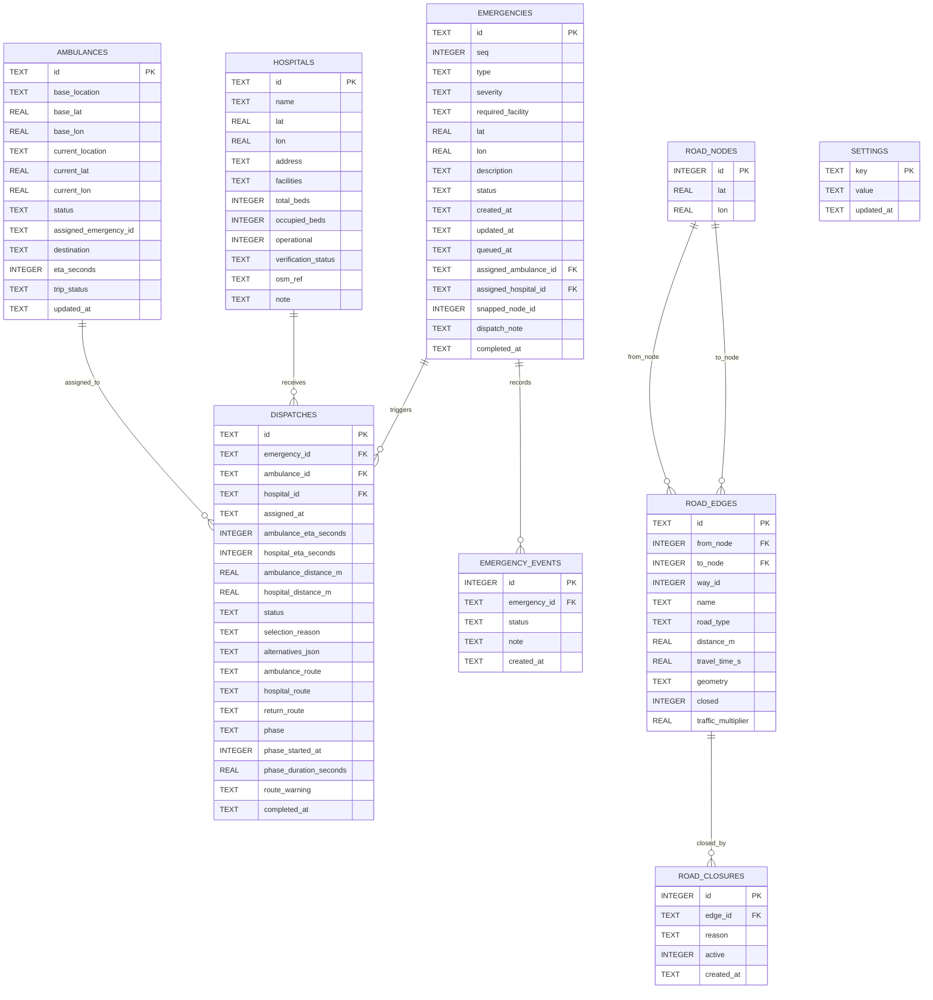

# Database Design

**Engine:** SQLite 3 (WAL mode)  
**File:** `data/arunai.db` (override with `ARUNAI_DB`)  
**Schema:** `src/main/resources/database/schema.sql`

SQLite is the durable source of truth. The in-memory road graph and priority
queue are rebuilt from it at startup, so a restart preserves every call,
dispatch, closure and audit event.

---

## 1. Entity-relationship diagram



---

## 2. Table notes

### `settings`
Key/value store. Defaults are inserted on first run. Holds operating area,
simulation speed/pause, return policy, demo admission and OSM provenance
(`osm_source`, `osm_bbox`, `osm_imported_at`, `osm_cache_file`,
`network_nodes`, `network_edges`, `demo_reset_at`).

### `ambulances`
Exactly the five demonstration units. `status` is constrained to the eight
operational states. `assigned_emergency_id` and `destination` describe the
active trip. Movement updates `current_lat/current_lon`, `eta_seconds` and
`trip_status`.

### `hospitals`
Five candidates. `lat/lon` are nullable: HOSP-05 has no verified location and
therefore cannot be routed. `facilities` is a comma-separated list of
`GENERAL`, `CARDIAC`, `TRAUMA`. `verification_status` records
`OSM_LOCATION_VERIFIED`, `OSM_LOCATION_VERIFIED_NAME_ALIAS`, `ADMIN_CONFIRMED`
or `UNVERIFIED`. `CHECK (occupied_beds <= total_beds)` protects bed data.

### `emergencies`
`seq` is unique and defines FIFO order. `status` follows the lifecycle enum.
`snapped_node_id` is the nearest OSM node used for routing. `dispatch_note`
explains why a queued call could not yet be assigned.

### `dispatches`
One row per assignment attempt that succeeded. Route geometry is stored as JSON
arrays of `{lat, lon}` so a restart can continue simulation. `phase` is one of
`TO_SCENE`, `AT_SCENE`, `TO_HOSPITAL`, `RETURNING`, `COMPLETED`.
`alternatives_json` preserves the complete candidate comparison and the
human-readable selection reason for audit and review.

### `emergency_events`
Append-only audit timeline: `REPORTED`, `QUEUED`, `ASSIGNED`,
`AMBULANCE_EN_ROUTE`, `ARRIVED_AT_SCENE`, `TRANSPORTING`,
`ARRIVED_AT_HOSPITAL`, `COMPLETED`, `CANCELLED`, plus route warnings.

### `road_nodes` / `road_edges`
The imported OSM graph. An edge is an undirected segment between two OSM nodes.
`travel_time_s` is the Dijkstra weight before the traffic multiplier.
`geometry` stores the full OSM shape. `closed` is checked in Dijkstra, so one
flag closes both directions.

### `road_closures`
Append-only closure history. Only rows with `active=1` are shown and count as
active. Closing inserts an active row; reopening marks the previous active row
inactive and inserts an audit row with `active=0`. This guarantees at most one
active closure per edge after any sequence of open/close operations.

---

## 3. Integrity rules

1. **No duplicate active ambulance assignment**

```sql
CREATE UNIQUE INDEX ux_active_dispatch_ambulance
  ON dispatches(ambulance_id) WHERE status = 'ACTIVE';

CREATE UNIQUE INDEX ux_active_dispatch_emergency
  ON dispatches(emergency_id) WHERE status = 'ACTIVE';
```

2. **Atomic reservation**

`DispatchRepository.createAssignment` runs in one transaction:

```text
BEGIN
  UPDATE ambulances
     SET status='EN_ROUTE', assigned_emergency_id=?, ...
   WHERE id=? AND status='AVAILABLE'
  -- must affect exactly 1 row

  INSERT INTO dispatches (...)
  UPDATE emergencies SET status='ASSIGNED', ...
   WHERE id=? AND status='QUEUED'
  -- must affect exactly 1 row
COMMIT
```

Any zero-row update throws `IllegalStateException`; the transaction rolls back.

3. **Bed sanity** — `occupied_beds <= total_beds`, both bounded.

4. **Status domains** — SQL `CHECK` constraints on ambulance status, severity,
   facility, dispatch status and closure flags.

5. **Referential integrity** — foreign keys are enabled on every connection.

---

## 4. Indexes

| Index | Purpose |
|---|---|
| `ix_emergencies_status(status, severity, created_at)` | queue/history reads |
| `ix_emergencies_created(created_at)` | newest-first lists |
| `ix_dispatches_emergency(emergency_id)` | lookup active dispatch |
| `ix_dispatches_ambulance(ambulance_id)` | lookup active trip |
| `ix_events_emergency(emergency_id, id)` | timeline |
| `ix_edges_type(road_type)` | stats and diagnostics |
| `ix_edges_name(name)` | road search |
| `ix_closures_active(active)` | active closure list |
| `ux_active_dispatch_ambulance` | uniqueness invariant |
| `ux_active_dispatch_emergency` | uniqueness invariant |

---

## 5. Data provenance fields

Every layer carries its own honesty marker:

- `settings.osm_source`: `OSM_OVERPASS`, `OSM_CACHE`, `SYNTHETIC_FALLBACK` or
  `NOT_LOADED`.
- `hospitals.verification_status` and `hospitals.note`.
- API booleans `bedDataSimulated`, `simulatedMovement`, `simulated`.
- UI labels `SIMULATED` / `DEMO` on bed, movement, closure and traffic controls.

No table stores real patient data. Descriptions and notes of seeded history
explicitly state that the row is simulated demonstration data.
